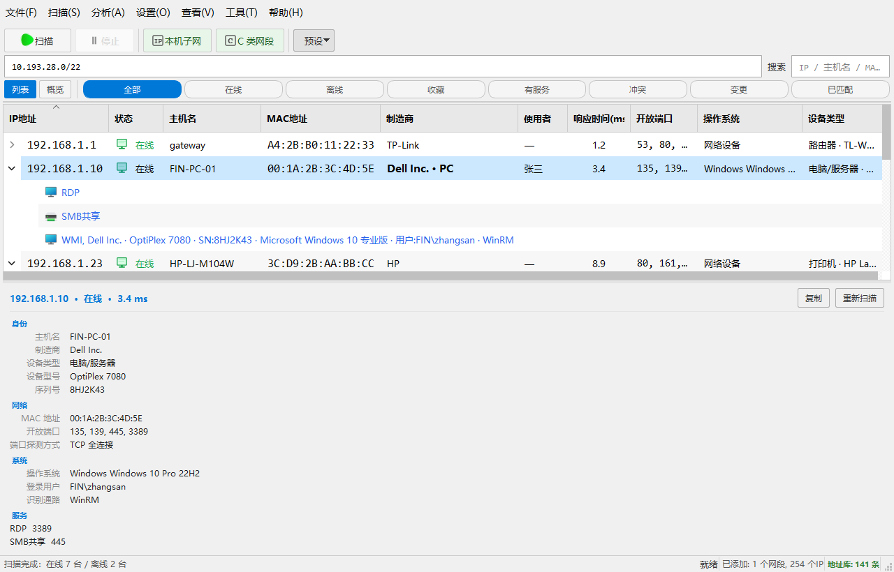

# IPScanner

[](https://github.com/kooofy/IPScanner/actions/workflows/ci.yml)
[](LICENSE)
[](pyproject.toml)

局域网终端扫描与资产识别工具 —— PyQt5 图形界面 + 无头命令行，面向**内网巡检、资产盘点、
IP 冲突排查**等日常运维场景。

- **一条命令扫完一个网段** —— `python cli.py scan -r 192.168.1.0/24 --format json`
- **不限设备 · 不限站点 · 无需账号 · 无需上云** —— 纯本地运行，数据只落在你自己的机器上
- **Windows 免安装包 + CLI + JSON** —— GUI 版解压即用，CLI 版单文件可直接进计划任务



---

## 横向对比

同类工具里最常被拿来对照的是 **Advanced IP Scanner**（免费、仅 Windows）、
**SoftPerfect Network Scanner**（桌面功能最密）与 **Total Network Inventory / TNI 6**
（最便宜的付费台账）。下表只列「决定要不要装」的那几项，以各家官方页面为准
（核对日期 2026-10，来源见 [`docs/research/`](docs/research/)）。

| | **IPScanner** | Advanced IP Scanner | SoftPerfect | TNI 6 |
|---|:---:|:---:|:---:|:---:|
| 价格 / 许可 | **免费 · GPL-3.0 开源** | 免费（闭源） | 试用限 10 台；商用 ¥329 起 | 30 天试用；~$90 / 25 节点 |
| 平台 | Windows 为主，macOS / Linux 可运行 | 仅 Windows | Win / macOS / Linux | Windows 控制台（可扫多平台） |
| 设备 / 站点上限 | **无** | 无 | 无（授权按安装数计） | 按节点数授权 |
| 账号 / 上云 | **不需要** | 不需要 | 不需要 | 不需要 |
| 命令行 / 自动化 | **有**（JSON / CSV，退出码语义固定） | 无 | 无 | 无 |
| 历史快照 + 变更对比 | **有** | 无 | 无 | 有（Change Log） |
| 定时扫描 + 告警 | **有**（系统计划任务 + 四类渠道 + 维护窗口/静音/去重） | 无 | 无 | 有（无 mute 窗口） |
| SNMP / 拓扑 | **有**（LLDP/CDP + BRIDGE-MIB，逐级退化不编造链路） | 无 | 无（拓扑另售） | 有（网络图，手工拖拽） |
| 风险评分 | **有**（0–100 服务暴露面） | 无 | 无 | 无 |
| 源码可审计 | **是** | 否 | 否 | 否 |

> **怎么读这张表**：它只回答「要不要装」，不回答「谁更强」。SoftPerfect 的**探测**能力比本项目
> 更多（IPv6、跨路由 MAC 识别、TLS 证书到期、Nmap 集成、远程执行），Advanced IP Scanner 有
> 7000 万用户与 ~35 种语言 —— 这两项都是本项目**没有**的。IPScanner 的差异集中在
> **台账**（快照 / 变更 / 拓扑）、**自动化**（CLI + 计划任务 + 告警）与**可审计**（GPL 源码）
> 这三块，且**不需要账号、不设设备上限**。
>
> 本项目的短板同样写在这里：**只支持 IPv4**（IPv6 字面量在输入阶段即被拒绝）、
> WMI 深度识别仅限 Windows 目标、发行版**未做代码签名**（见下文「Windows 上的
> 「未知发布者」与杀软误报」）。

---

## English Overview

**IPScanner** is a LAN host discovery and asset-identification tool for Windows-centric
networks, written in Python + PyQt5. It ships both a desktop GUI and a headless CLI
(`scan` / `diff` / `history`) so the same engine can drive interactive inspection and
scheduled automation.

Key capabilities:

- Range scanning over CIDR / IP ranges / multiple segments, with three port-scan depths
  (21 / 1023 / 65535 ports) and three probe modes (TCP connect / TCP SYN half-open / UDP).
- Liveness detection via ICMP **plus** active ARP probing, so hosts that block ping are
  still discovered.
- Device identification: MAC vendor lookup (updatable OUI database), device-type and
  model inference, OS fingerprinting, mDNS/DNS-SD discovery, NetBIOS names, and optional
  credential-based WMI interrogation.
- Asset history snapshots with change diffing, IP-conflict detection, subnet utilisation
  analysis, and topology mapping via SNMP: CDP/LLDP for the switch backbone plus
  BRIDGE-MIB forwarding tables for per-port device attachment.
- Bilingual UI (简体中文 / English), Excel / CSV / HTML / JSON export.

Licensed under **GPL-3.0** (required because PyQt5 is used under its GPL terms).
Requires Python 3.10–3.13. See [快速开始](#快速开始) for setup.

---

## 功能特性

### 扫描与发现

| 能力 | 说明 |
| --- | --- |
| 扫描范围 | 单个 IP、CIDR（`192.168.1.0/24`）、IP 区间（`10.0.0.1-10.0.0.200`）、多个网段批量（仅 IPv4） |
| 扫描深度 | `快速 (21)` / `标准 (1023)` / `全端口 (65535)` 三档 |
| 探测方式 | TCP 全连接 / TCP SYN 半开 / UDP 探测，可随时切换 |
| 存活探测 | **原生 ICMP**（Windows `IcmpSendEcho` / Unix raw socket，零依赖、零管理员）+ **ARP 主动探测**（能发现禁 Ping 的主机）+ mDNS 组播发现 |
| 被动发现 | **不发任何网络包**地看「最近谁在我身边出现过」——本机 ARP 整表 + mDNS **只听**模式；只报「新出现」，不报「消失」 |
| 并发 | 线程数可调（默认 100），RTT 自适应端口超时；端口探测走**进程内单例有界池**（上限 384） |

> **存活探测为什么用原生 ICMP**：旧实现每个 IP 起一个 `ping` 子进程，/24 就是 254 次
> 进程创建、/16（本项目上限）是 65536 次。Windows 上单次进程创建约 10~20ms，这部分
> 开销往往比真正的网络等待还大 —— 这是与 Advanced IP Scanner / nmap 最主要的体感差距。
> 现在默认走 Windows `iphlpapi.IcmpSendEcho`（用户态导出，**零第三方依赖、零管理员
> 权限**，与已有的 `SendARP` 是同一套 ctypes 手法）或 Unix 的 raw socket；
> 拿不到权限时自动回退子进程 `ping`，功能不降级。
> 实测单次探测：有响应主机 0.7ms vs 251ms（约 370×），不可达主机 0.19s vs 1.56s（32 地址并发）。
>
> **端口探测为什么要收敛线程池**：端口扫描在流水线里是**按设备**反复调用的
> （enrich 阶段并发 50 台，每台还要为协议端口再扫一次）。旧实现每次调用都新建一个
> 线程池，最坏组合（standard 档 1023 端口）会在创建/销毁中抖动出数千个线程。
> 现在改为**进程内单例有界池**（上限 384）：一次创建、跨设备跨扫描复用，线程数有硬上限。
> 实测现实负载（快 LAN / 多数端口关闭）下耗时与旧实现持平或略快，而线程数大幅下降；
> 只有"整台主机端口全被防火墙丢包"的极端场景才有约 7% 的时延代价。
> 另外，完整端口扫描已覆盖协议端口（80/443/21/3389）时不再重复探测，省掉一次多余往返。
>
> **connect 扫描为什么默认走异步（v2.1 §2.1）**：Windows 上 SYN 半开扫描依赖 Npcap，
> 而 Npcap 免费授权禁止再分发、不能随包捆绑，于是绝大多数用户的结果只能来自 connect。
> connect 的真正瓶颈是"同时在飞的 socket 数"，而 OS 线程有实打实的成本（Windows 默认
> 1MB 栈、上下文切换）。现在 connect 默认改用 **`asyncio` + ProactorEventLoop(IOCP)**：
> **一个线程**就能挂起上千个 connect，**不需要任何驱动、不需要管理员**。实测本机 2000 个
> 关闭端口从 1.30s 降到 0.65s（**约 2× 提速**）。三条回退护栏保证可回滚：环境变量
> `IPSCANNER_TCP_ENGINE=threaded` 强制回到线程池、非 Windows（无 Proactor）自动回退、
> 运行期出错自动回退并记 warning。SYN/UDP 模式不变（仍走线程池）。

> **被动发现为什么默认「只听」**：它读本机 **ARP 整表**（Windows `arp -a` /
> Linux `/proc/net/arp` / macOS `arp -an`）并加入 mDNS 组播组，**只收不发** ——
> 一个包都不发，不惊动 IDS 与流量审计。需要更全的发现能力时才用 `--mdns-active`
> 显式开启主动查询（那会发组播包）。另外它**只报「新出现」，不报「消失」**：
> ARP 条目会过期，设备从表里消失不等于它下线了，报「消失」就是假阳性。
> CLI `ipscanner watch`（`--interval` 持续轮询、`--fail-on-change` 有新设备时退出码 2）；
> GUI 在「设置 → 持续发现」（**默认关**），打开后每 30 秒后台轮询一次。

> **IPv6 可见性（只做可见性，不扫 IPv6）**：现代网络里设备普遍带 IPv6，只看 IPv4
> 会漏掉「只有 IPv6 的设备」。但**完整的 IPv6 资产盘点在语义上不成立** —— 一个 /64
> 有 2⁶⁴ 个地址。所以本工具**只做可见性**：读本机 **NDP / IPv6 邻居缓存**
> （Windows `netsh interface ipv6 show neighbors` / Linux `ip -6 neigh` /
> macOS `ndp -an`，**零发包**），把地址**按 MAC 挂到已有 IPv4 设备上**，
> **不新建**「IPv6-only 资产」。用 `watch --ipv6` 开启（默认关）。
> 另有 `--ipv6-probe` 会向 `ff02::1` 发**一次** ICMPv6 echo（**唯一会发包的一步**，
> 需要管理员/root，默认关），促使设备回邻居通告。
> ⚠ 本项产出的是「**可见性**」，不是「**IPv6 资产清单**」。

### 识别与指纹

- **MAC 厂商库**：内置 OUI 数据库，支持在线更新；未知厂商可按前缀批量查询。
- **设备类型与型号**：综合端口、服务 banner、mDNS、UPnP、SNMP、OUI 线索推断。
- **操作系统**：TTL 推测 + 服务 banner 版本提取。
- **服务版本指纹库**：把服务 banner 解析为「服务 / 产品 / 版本」，覆盖
  SSH、HTTP、FTP、SMTP、POP3、IMAP、Telnet、VNC、MySQL·MariaDB、
  Redis、PostgreSQL、MongoDB、RDP 等内网高频服务。
  规则放在 `service_fingerprints.json`，查找策略与 `oui.db` 一致
  （**用户数据目录优先 → 内置回退**）：把新版 JSON 放进数据目录即可生效，
  补一条指纹无需发版。数据文件缺失/损坏或单条正则写错都会自动回退到
  内置规则，不会让"指纹库坏了"升级成"扫描失败"。
  探测**只做无凭据识别**，不发送任何需要认证的请求。
- **mDNS / DNS-SD**：发现打印机、NAS、Apple 设备、IoT 等组播设备（无需扫描也可单独运行）。
- **NetBIOS**：UDP/137 NBSTAT 查询计算机名与工作组，零凭据、不需管理员。
- **WMI 远程识别**：经 PowerShell CIM 取权威硬件/系统信息（需管理员凭据；
  密码经 DPAPI 加密后本地存储，仅通过子进程环境变量传递，不出现在命令行）。
  支持 **DCOM 与 WinRM 双传输**：默认先试 DCOM，快速失败后自动回退 WinRM（只需
  5985 单端口，跨网段更易通过），也可在凭据对话框里指定单通路。
- **SMB 共享枚举**：列出目标开放共享。
- **SNMPv3（USM）**：支持用户级认证与加密，取代明文团体字。
  认证 `HMAC-MD5-96` / `HMAC-SHA-96`，加密 `AES-128-CFB128`；
  未配置用户时自动回退到 v2c 团体字探测。凭据同样经 DPAPI 加密落盘，
  配置对话框内可对指定 IP 直接"测试"连接。
  （不支持已废弃的 DES 隐私协议。）

### 资产管理与分析

- **设备定位（这台设备插在哪）**：给定 MAC / IP / 主机名，查出它接在**哪台交换机的
  哪个物理口**，并给出与上一次相比**是否换过端口**。匹配**优先用 MAC** —— IP 会被
  DHCP 回收后分配给另一台机器，MAC 才是设备身份。数据来自扫描时可选采集的交换机
  转发表（SNMP BRIDGE-MIB），所以**采集是显式开关、默认关**（每台交换机要 5 次
  SNMP walk，会在网络里产生额外流量）。查不到时**不猜**，而是区分四种「不知道」
  （从未采集过转发表 / 采集了但交换机都读不到 / 转发表里没有这台设备 / 历史库里
  根本没有它）并各自给出下一步动作；端口名只有桥接端口号时标注「不可信」，
  不把它当成 `GigabitEthernet0/5` 糊弄过去。
  GUI「分析 → 设备定位…」（`Ctrl+L`）/ CLI `ipscanner locate --mac …`。
- **历史快照**：每次扫描可存为快照，支持跨快照聚合查询（按设备类型 / 网段 / IP 过滤）。
- **变更对比**：对比两次快照，列出新增 / 消失 / 属性变更的设备。手机默认开启的
  「私有 Wi-Fi 地址」会让同一台设备每次接入换一个随机 MAC —— 变更检测会先用
  **设备指纹**（主机名 / 厂商 / 型号 / 序列号）把同一台认回来，报「随机 MAC 重现」
  而不是「新增 + 消失」；指纹对不上时如实报，不猜。
- **定时扫描 + 变更告警**：注册为系统计划任务（Windows `schtasks` / Linux·macOS `crontab`），
  无人值守地周期性扫描并在资产变化时推送告警到 Webhook / 企业微信 / 钉钉 / 邮件；
  支持**维护窗口 / 静音 / 通知去重**，不让告警变成噪声源
  （零第三方依赖；敏感值支持 `env:` 间接引用，不落盘）。
- **IP 冲突检测**：识别同一 IP 对应多个 MAC 等异常，按严重级别分级。
- **子网利用率**：按 `/24` 聚合统计在线/离线数量与利用率。
- **拓扑发现**：按"真实数据优先、逐级退化"还原真实连接，全程不画假链路；每一档退化都会
  在图例里写明原因。四档退化链路：
  - **第 1 档 · 骨干链路（LLDP / CDP）**：优先用 **LLDP**（IEEE 802.1AB，多厂商）发现交换机
    之间的互联；Cisco 系则退回 **CDP**（专有），且能直接报出对端是交换机还是路由器。
    要看交换机之间的骨干链路，设备需启用 LLDP 或 CDP。
  - **第 2 档 · 接入层兜底（BRIDGE-MIB 转发表）**：只要交换机**开了 SNMP 且支持 BRIDGE-MIB**，
    即使没开 LLDP/CDP，也能还原「每台终端挂在哪台交换机的哪个物理口」，并据此反推交换机
    之间的上联关系（转发表是交换机自己学到的数据，不依赖终端配合）。
  - **第 3 档 · 已识别但无链路**：设备已被 SNMP 识别为交换机/路由器，但没上报 LLDP/CDP、
    转发表也不可用 —— 图例说明原因，不编造链路。
  - **第 4 档 · 网段分层**：SNMP 完全不可达、一条链路都发现不了时，按 `/24` 网段分层展示
    （网关识别为路由器），图例同样说明原因（通常是交换机没开 SNMP）。
  前提：交换机/路由器上开启 SNMP（v2c 团体字，或配置 SNMPv3 用户；**v3 优先、仅无响应才回退 v2c**）。
  扫描时**不必**勾选「SNMP 协议」——拓扑发现会自己主动发 SNMP GET / 遍历去确认，不依赖扫描是否先识别过 SNMP。
  （效果示意：[拓扑视图预览](docs/reviews/topology_preview.png)，由模拟网络数据渲染）
- **地址库匹配**：导入 Excel 设备清单（`设备清单模板.xlsx`），扫描时自动匹配设备归属
  （位置 / 使用人 / 备注）。
- **审计日志**：记录扫描、导出、设置变更等关键操作，可按分类与关键字检索。
- **导出**：Excel / CSV / HTML / JSON。

### 界面与交互

- **设备详情面板**：表格下方常驻面板，选中设备即显示身份 / 网络 / 系统 / 服务 / 风险
  五个分区；可拖拽调整高度，也可一键重扫该设备或复制整份信息。
- **概览仪表盘**：与列表并列的结果视图（工具栏「列表 / 概览」切换，选择会被记住）。
  一屏给出设备总数、在线率、变更、风险、服务暴露、Top 厂商、设备类型与子网利用率。
- **变更时间线**：把「对比两次快照」从手动操作变成常驻视图 —— 筛选条新增「变更」chip，
  行内直接标注 `＋新增 / ↑ 改址 / ✎改名 / ✗消失`，详情面板给出该设备的历史轨迹。
- **筛选条带计数**：在线 / 离线 / 收藏 / 有服务 / 冲突 / 变更 / 已匹配 各带实时计数，
  常驻可见（放不下时横向滚动，绝不截断文字）。
- **列预设与扫描预设**：一键在「巡检 / 资产 / 安全 / 全量」四种列组合间切换；
  常用网段 + 扫描深度可存为预设，下次一键复用。
- **风险列**：给每台设备一个 0–100 的**服务暴露面**评分 —— 明文 Telnet / FTP / TFTP、
  无认证 VNC、SNMP v2c 团体字、以及"只开了 HTTP 而没开 HTTPS"，再加上 MAC / 主机名冲突。
  按「高 / 中 / 低」着色，鼠标悬停可看到分数是怎么一项项加出来的。
  它刻意**不**把"是否登记在地址库"算进去（那是「资产」视角的事）：否则在用户还没导入
  台账之前，整列都是同一个数字，这一列立刻变成噪声。普通 Windows 主机
  （135/139/445/3389）得 0 分，显示为「—」。
- **设备收藏**：星标关注的设备，配合「收藏」筛选快速定位。
- **主题**：浅色 / 深色 / **跟随系统**（读 Windows 个性化设置）/ 按时间自动切换。
- **空状态引导**：未扫描时给出「本机网段」等入口提示，而不是一张空白表格。

### 内置网络工具

Ping、Tracert、Telnet、SSH、RDP、命令提示符、远程关机 / 重启。

> 出于安全考虑，这些工具的目标参数经过白名单校验，只接受 IP 字面量或纯 ASCII 主机名，
> 以杜绝命令注入。

---

## 快速开始

### 环境要求

- **Python 3.10 ~ 3.13**
- Windows 10/11（主平台）；macOS / Linux 亦可运行，但 WMI 识别等部分能力仅 Windows 可用
- 部分功能需要管理员权限（SYN 半开扫描、ARP 主动探测、远程关机/重启）

### 安装与运行

**方式一：一键脚本（Windows）**

```bat
run.bat
```

`run.bat` / `run.ps1` 会自动创建 `venv`、安装依赖并启动程序。首次运行需要几分钟。

**方式二：手动**

```bash
python -m venv venv
venv\Scripts\activate            # macOS / Linux: source venv/bin/activate
pip install -r requirements.txt
python main.py
```

### Windows 上的「未知发布者」与杀软误报

发行版**当前未做代码签名**，所以从 Release 下载的 zip 解压后首次运行，Windows 大概率弹出
**「Windows 已保护你的电脑」/ 未知发布者**。这是 SmartScreen 对"没有签名记录的新程序"的
默认反应，**不代表程序有问题**。

> 本项目**正在申请** [SignPath Foundation](https://signpath.org) 的免费开源代码签名
> （材料与提交步骤见 [`docs/SIGNPATH_APPLICATION.md`](docs/SIGNPATH_APPLICATION.md)）；
> 获批后发行版会带上**可与本仓库相互验证**的签名，届时本节会同步更新。
>
> 另外提醒一句：**买 EV 证书并不能免除拦截** —— 2024 年起微软取消了 EV 的即时信任特权，
> OV / EV 的新签名文件都得靠下载量累积信誉，而 EV 价格是 OV 的数倍。本项目不走这条路。

继续运行：

1. 在蓝色提示框里点「更多信息」→「仍要运行」；
2. 若被浏览器先拦下，在下载项上右键 →「保留」。

杀软 / EDR 误报是同一类原因：本工具要主动发送 ICMP / ARP / TCP / UDP 报文、读取 WMI、
调用 `net view`，这些行为特征与恶意软件高度重叠，启发式引擎容易误判。被隔离时：

- **Microsoft Defender**：`Windows 安全中心 → 病毒和威胁防护 → 保护历史记录`，
  选中对应条目 →「允许在设备上」；也可向
  [Microsoft 提交误报](https://www.microsoft.com/en-us/wdsi/filesubmission)。
- **第三方杀软**：各家都有误报申诉入口（卡巴斯基 OpenTIP、火绒论坛、VirusTotal 的
  引擎页面等），提交时附上本仓库地址能显著加快处理。

想彻底绕开分发链上的信誉问题，也可以**从源码运行**（见上文「方式二：手动」），或
自行执行 `pyinstaller IPScanner.spec` 构建 —— 自己编译的产物没有"未签名的新下载文件"
这个触发条件。

### 使用流程

1. 在顶部输入框填入网段（如 `192.168.1.0/24`），点「添加」或直接回车加入待扫列表；
   也可点「本机网段」自动填入。
2. 选择扫描深度与探测方式（`扫描 > 扫描设置...`）。
3. 点「开始扫描」。结果按行展示，双击设备行可展开端口/服务、WMI、NetBIOS 等细节。
4. 选中设备后可执行 WMI / NetBIOS 识别、打开内置网络工具。
5. `文件 > 导出` 导出结果；`历史` 菜单管理快照与变更对比。

---

## 命令行（无头模式）

`cli.py` 提供与 GUI 共用同一引擎的无头入口，适合计划任务、SSH 远程巡检、CI 集成。
输出格式稳定（JSON 键为英文、退出码语义固定），便于脚本消费。

```bash
# 扫描网段，输出 JSON
python cli.py scan -r 192.168.1.0/24 --level quick --format json

# 目标写在文件里（-iL，nmap 习惯）：每行一个 CIDR/IP，# 开头为注释，空行跳过
# 合法行全部收用；非法行报错并给出行号。与 -r 至少其一，也可同时用
python cli.py scan -iL targets.txt --level quick

# 只输出在线设备，写入文件
python cli.py scan -r 10.0.0.1-10.0.0.200 --online-only --format csv -o result.csv

# 扫描并存为历史快照
python cli.py scan -r 192.168.1.0/24 --save-snapshot --note "周一巡检"

# 扫描时顺带读取各交换机转发表（记录"哪台设备在哪个口"），随快照落库
python cli.py scan -r 192.168.1.0/24 --save-snapshot --switch-map

# 安全体检：编一个不存在的主机名查一次 LLMNR/NBNS，看谁给肯定应答
# （会向网络发送组播/广播包；加 --save-snapshot 才会写进快照）
python cli.py scan -r 192.168.1.0/24 --name-responder --save-snapshot

# 有变更时推送告警（走 notify.json 里的渠道与告警策略）
python cli.py scan -r 192.168.1.0/24 --save-snapshot --notify
python cli.py scan -r 192.168.1.0/24 --save-snapshot --notify --no-policy  # 忽略维护窗口/静音/去重

# 定位：这台设备接在哪台交换机的哪个口（含与上次的端口变化）
python cli.py locate --mac AA:BB:CC:DD:EE:FF
python cli.py locate --ip 192.168.1.50 --format json

# 扫描活动自查：过去 24h / 7 天 / 全部历史，向哪些网段发起了多少次扫描
# （只读本机审计库，不联网；空数据会说明原因而不是给一张空表）
python cli.py audit --window 168
python cli.py audit --format json

# Nagios / Icinga 插件：一次性执行，退出码 0/1/2/3 = OK/WARNING/CRITICAL/UNKNOWN
# （不常驻、不开端口；数据过期或没有快照时报 UNKNOWN，不猜成 OK）
python cli.py nagios --crit-new 3

# 被动发现：不发任何网络包地看"最近谁在我身边出现过"
python cli.py watch                       # 读 ARP 表 + 只听 mDNS，单次轮询
python cli.py watch --no-mdns             # 只读 ARP 表（最快，几十毫秒）
python cli.py watch --fail-on-change      # 有新设备时退出码 2（便于计划任务告警）
python cli.py watch --interval 60         # 每 60 秒轮询一次，Ctrl+C 停止
python cli.py watch --ipv6                # 同时挂靠 IPv6 地址（只读 NDP 缓存，零发包）
python cli.py watch --ipv6 --ipv6-probe   # 先向 ff02::1 发一次多播（需管理员/root）

# 对比资产变更（相对上一次快照；有变更时退出码为 2）
python cli.py diff -r 192.168.1.0/24 --fail-on-change

# 跨快照聚合查询：所有打印机
python cli.py history --query --device-class 打印机 --format json

# 列出 / 导出历史快照
python cli.py history --list
python cli.py history --show 12 --format csv -o snapshot12.csv

# 资产表：按 MAC 身份键去重后的设备清单（换过 IP 的设备只算一台）
python cli.py assets --count
python cli.py assets --device-class 交换机 --format json

# 导出资产表为互操作格式（供别的系统解析；纯文件、语言无关）
python cli.py export -f nmap     -o nmap.xml        # Nmap XML
python cli.py export -f zabbix   -o zabbix_lld.json # Zabbix LLD
python cli.py export -f netbox   -o netbox.csv      # NetBox 设备 CSV
python cli.py export -f oxidized -o router.db       # Oxidized router.db

# 读入外部 Nmap XML（nmap -oX 的产物）并入资产表
python cli.py import nmap_scan.xml                 # 默认只预演，不改台账
python cli.py import nmap_scan.xml -f json         # 预览为 JSON
python cli.py import nmap_scan.xml --save          # 确认无误后写库

# 拓扑导出为可读文本（tree / markdown / ascii，语言无关）
python cli.py topology -r 192.168.1.0/24 -f tree -o topo.txt

# 端口利用率：每台交换机各端口接了几台设备（「还有几个口可用」）
python cli.py ports                 # 表格
python cli.py ports -f json         # 便于脚本消费（含 reason 字段）

# 注意：ports 的数据依赖扫描时显式加 --switch-map（默认关闭）：
python cli.py scan -r 192.168.1.0/24 --save-snapshot --switch-map
# 未采集过时 ports 会说明是「没采过」并给出上面这条命令，不会给你一张空表。
# 另：只统计「接了什么」，不含空闲口 —— 转发表里没有空闲口的记录。
```

> ⚠ **`import` 的两个语义提醒**：① Nmap 的 `up` 只表示「至少一个探针有回应」、
> `down` 可能是被屏蔽 —— 它与本工具的 `status` **不等价**，因此解析结果里
> 保留了原样的 `nmap_state` 与 `source=nmap` 供溯源；② 默认**只预演**
> （打印 up/down/未知 计数与表格），确认无误再加 `--save` 写库。

**退出码**

| 码 | 含义 |
| --- | --- |
| `0` | 成功 |
| `1` | 错误（如 `--fail-if-empty` 且无结果） |
| `2` | 检测到变更（`diff --fail-on-change`、`watch --fail-on-change`） |
| `3` | 环境错误（如数据目录不可写） |
| `4` | 未定位到设备（仅 `locate`；查询本身成功，是一个合法结论而非错误） |

> `locate` 的数据来自扫描时按需采集的交换机转发表。没采集过时它**不会猜**，
> 而是说明是哪一种「不知道」（从未采集 / 采集失败 / 转发表里没有它）并给出下一步动作。

> `watch` 是**被动**的：默认只读本机 ARP 表并**只听** mDNS 组播（绑 5353、加入组播组、
> 只收不发），**一个包都不发**，因此不惊动 IDS 与流量审计。它只报「新出现」的设备，
> 不报「消失」—— ARP 条目会过期，设备从表里消失不等于它下线了。
> 它**默认也不写快照**（快照有 20 条上限，持续轮询会把历史冲掉）；
> 要落库请用 `watch --once --save-snapshot`，交给计划任务定时调用。

**语言**：`--lang zh-CN` / `--lang en-US`，默认跟随系统。

**编码**：stdout / stderr 一律以 **UTF-8** 输出，消费端请按 UTF-8 解码。
Windows 上输出被重定向到管道或文件时（CI、`> out.json`、`| jq`），
系统默认会改用 ANSI 代码页（英文系统为 cp1252），而 stdout 的默认错误处理器是
`strict` —— 一旦输出里有中文（设备名、`device_class`、表格）就会直接抛
`UnicodeEncodeError` 并以退出码 1 结束。CLI 在解析参数之前会主动把两个流切到
UTF-8，因此 `--help` 与所有输出在任何代码页下都能正常工作。

**SNMPv3（USM）**

口令**只从环境变量读取**，没有任何接受口令的命令行选项 —— argv 会出现在进程列表
（`ps` / 任务管理器）里，同机任何用户都能看到。

```bash
export IPSCANNER_SNMPV3_AUTH_KEY='认证口令'
export IPSCANNER_SNMPV3_PRIV_KEY='加密口令'

# authPriv：SHA 认证 + AES-128 加密
python cli.py scan -r 192.168.1.0/24 --snmpv3-user monitor \
    --snmpv3-auth sha --snmpv3-priv aes

# 用自定义环境变量名，便于在同一台机器上为不同目标准备不同凭据
python cli.py scan -r 10.0.0.0/24 --snmpv3-user monitor \
    --snmpv3-auth md5 --snmpv3-auth-env SITE_A_SNMP_KEY
```

指定 `--snmpv3-user` 会**自动启用** SNMP 协议识别，无需再写 `--protocols SNMP`。
口令缺失或组合非法（如只给 `--snmpv3-priv` 不给 `--snmpv3-auth`）时，
会在**扫描开始前**报错并以退出码 `1` 结束，不会白扫一个网段。

**凭据配置档（按网段用不同只读账户）**

真实企业里不同网段属于不同团队、用不同的只读账户；全局单一值要么不合规（全用同一个），
要么每次手改（易错）。凭据配置档把凭据变成**带作用域的一组对象**，扫描时**按目标 IP
做最长前缀匹配**自动选档。配置文件默认在数据目录的 `credentials.json`：

```json
{"profiles": [
  {"name": "办公网", "scope": ["10.1.0.0/16"],
   "protocol": "snmp_v2c", "community": "env:OFFICE_SNMP"},
  {"name": "机房", "scope": ["10.1.2.0/24", "10.2.0.0/16"],
   "protocol": "snmp_v3", "username": "monitor",
   "auth_proto": "sha", "auth_key": "env:IDC_AUTH",
   "priv_proto": "aes", "priv_key": "env:IDC_PRIV"}
]}
```

```bash
export OFFICE_SNMP='办公网团体字'
python cli.py scan -r 10.1.0.0/16 --credentials credentials.json
python cli.py credentials --file credentials.json          # 查看 / 校验
```

- **敏感值走 `env:VAR` 间接引用**，明文绝不落盘（与 SNMPv3 口令同一条原则）。
- **最长前缀匹配**：`10.1.0.0/16` 与 `10.1.2.0/24` 并存时，`10.1.2.5` 命中更具体的 `/24`。
- 🔴 **选不到就明确报「该目标无可用凭据」，绝不静默回落 `public`** ——
  回落会让用户以为"扫过了"，其实用的是猜的团体字。
- 不指定 `--credentials` 时**行为与历史逐字节一致**（老用户零感知）。

### 定时扫描与变更告警

资产监控的价值在于"变化发生时被看见"，而不是"有人想起来时才扫一次"。
`schedule` 子命令把「扫描 → 存快照 → 对比上次基线 → 有变更就推送告警」
注册成**系统计划任务**，实现无人值守。

```bash
# 每天 09:00 扫描并告警（Windows 走 schtasks，Linux/macOS 走 crontab）
python cli.py schedule --register -r 192.168.1.0/24 --freq daily --at 09:00

# 每 30 分钟一次，且以最高权限运行（SYN 半开 / ARP 探测需要管理员权限）
python cli.py schedule --register -r 10.0.0.0/24 --freq minute --interval 30 --highest

# 查询 / 卸载
python cli.py schedule --status
python cli.py schedule --unregister
```

> **为什么是系统计划任务，而不是应用内定时器？**
> 应用内定时器要求 GUI 一直开着——关窗、注销、重启都会让监控**静默中断**，
> 而用户不会收到任何提示。交给系统调度器则天然满足"机器开着就一定会跑"，
> 且扫描发生在独立进程里，不会因 GUI 卡顿而漂移。

**通知渠道配置**：默认读取数据目录下的 `notify.json`（可用 `--notify-config` 指定）。
支持通用 Webhook、企业微信群机器人、钉钉群机器人（含加签）、SMTP 邮件四类，全部仅用标准库实现。

```json
{
  "channels": [
    {"type": "wecom",    "url": "env:IPSCANNER_WECOM_URL"},
    {"type": "dingtalk", "url": "env:DING_URL", "secret": "env:DING_SECRET"},
    {"type": "email",    "host": "smtp.example.com", "user": "ops@example.com",
     "password": "env:SMTP_PASS", "recipients": ["oncall@example.com"]}
  ]
}
```

- **敏感值不落盘**：webhook URL 里的机器人 token、SMTP 口令都支持
  `env:VAR_NAME` 间接引用，实际值从环境变量读取。配置文件常被复制、备份、误提交，
  明文放进去等于泄露——这与 SNMPv3 口令"只走环境变量"是同一条原则。
- **失败隔离**：任一渠道挂掉不影响其余渠道；逐个回传结果，配错一个渠道不会让整套告警失效。
- **业务错误也算失败**：企业微信 / 钉钉即使业务失败也返回 HTTP 200，错误藏在 body 的
  `errcode` 里。只看状态码会把"机器人被禁用""token 失效"当成发送成功——**告警静默丢失
  比告警发不出去更危险**，因此这类响应一律判定为失败。
- **无变更不发告警**：每 30 分钟推一条"无变更"只会把渠道变成噪音，
  真正需要被看见的变更反而被淹没；首次运行只告知"基线已建立"。

**告警抑制**：光有渠道还不够 —— 同类产品被抱怨最多的一条就是**告警噪声**
（打印机检修期间每半小时报一次"设备消失"、凌晨备份窗口里推一堆下线通知）。
同一个 `notify.json` 里可以声明三类规则，**只作用于通知**：

```json
{
  "channels": [ ... ],

  "dedup": {"window_minutes": 60, "key": "device_type"},

  "maintenance_windows": [
    {"name": "夜间备份", "days": ["mon", "tue", "wed", "thu", "fri"],
     "start": "01:00", "end": "04:00",
     "ranges": ["10.0.0.0/24"], "types": ["device_gone"]}
  ],

  "mutes": [
    {"name": "打印机检修", "mac": "AA:BB:CC:DD:EE:FF", "until": "2026-11-01"},
    {"name": "测试网段", "range": "10.9.0.0/16", "types": ["new_device"]}
  ]
}
```

- **维护窗口**：`days` 可写 `mon`/`monday`/`周一`/`0`，或用 `工作日` / `周末` 简写；
  省略 `days` 表示每天。支持跨午夜（`23:00`–`02:00`，此时 `days` 指**起始日**）。
  `ranges` / `devices` / `types` 都是可选的额外限定，三者与「时段」是**与**关系。
- **静音**：`mac` / `ip` / `range` 任选，可叠加 `types` 与 `until`。
  `until` 只写日期（`2026-11-01`）时按**当天结束**处理。什么都没写的静音规则
  会静音一切，属于漏配字段，会被忽略并记 warning。
- **通知去重**：同一 `(设备, 变更类型)` 在 `window_minutes` 内只发一次；
  `key` 可选 `device_type`（默认）/ `device` / `ip` / `type`。
  **状态落盘**（数据目录 `alert_dedup.json`）—— 定时扫描由系统调度器以**独立进程**
  拉起，只存内存等于没有去重。
- **抑制 ≠ 隐藏**：被抑制的变更**照常计入退出码与审计日志**，只是不发通知。
  「静音」是给人耳的，「退出码」是给机器的 —— CI 需要真实信号，不该被静音吃掉。
  部分抑制时，告警正文会附一行「另有 N 条被抑制」，让收件人知道全貌。
- **发送成功才记账**：渠道全部失败时不写去重状态，下一轮会重试 ——
  否则一次网络抖动就会让这条变更永远沉默。
- **失败安全**：配置写错一律**不抑制**（宁可多报，不可漏报）。
- 需要排障时用 `scan --notify --no-policy` 忽略全部策略。

---

## 项目结构

```
IPScanner/
├─ main.py                    # GUI 入口（含全局异常兜底）
├─ cli.py                     # 无头 CLI 入口
│
├─ main_window.py             # 主窗口（由下列 Mixin 组合而成）
│  ├─ scan_mixin.py           #   扫描流程编排
│  ├─ history_mixin.py        #   历史快照 / 审计日志 / 拓扑
│  ├─ export_mixin.py         #   导出
│  ├─ library_mixin.py        #   地址库
│  ├─ oui_mixin.py            #   OUI 更新
│  ├─ network_tool_mixin.py   #   内置网络工具
│  ├─ watch_mixin.py          #   持续发现（被动发现定时轮询 + 新设备并入列表）
│  └─ main_window_tree.py     #   结果树构建与刷新
│
├─ ui_dialogs/                # 各类对话框（按用途拆包，见 docs/refactor/）
│  ├─ __init__.py             #   re-export 门面（from ui_dialogs import X 不变）
│  ├─ _shared.py              #   对话框公共助手（截断 / 半透明 / 按主题取色）
│  ├─ library.py              #   设备编辑 + 地址库管理
│  ├─ credentials.py          #   WMI / SNMPv3 凭据采集
│  ├─ history.py              #   历史快照对比 + 条件查询
│  ├─ topology.py             #   网络拓扑视图（LLDP / CDP / 转发表）
│  ├─ reports.py              #   冲突 / 子网利用率 / 变更报告
│  ├─ audit.py                #   审计日志查看器
│  ├─ locate.py               #   设备定位（MAC/IP/主机名 → 交换机端口 + 最近变化）
│  └─ switch_port.py          #   交换机端口映射
├─ ui_logic.py                # 与 UI 解耦的纯业务逻辑（便于单测）
├─ ui_threads.py              # 后台线程（扫描 / mDNS / WMI / NetBIOS / 拓扑 / 历史查询 / OUI 更新 / 被动发现）
├─ ui_icons.py                # 图标与调色板工具（PC 图标预渲染、工具栏矢量图标、深色 QPalette）
├─ ui_msg.py                  # 对话框统一入口（顺带本地化 Qt 内置按钮文案）
├─ ui_utils.py                # 通用工具（网关探测、快照对比、IP 校验与排序键）
├─ detail_panel.py            # 设备详情面板
├─ empty_state.py             # 未扫描时的空状态引导页
├─ overview.py                # 概览仪表盘（渲染层，统计在 ui_logic.build_overview）
├─ filter_bar.py              # 结果筛选条（带计数、放不下时横向滚动）
├─ favorites.py               # 设备收藏（按 MAC 优先，退化为 IP）
├─ scan_presets.py            # 扫描预设（网段 + 深度）
├─ scan_status.py             # 扫描态摘要条（阶段 / 已扫 / 在线 / 有服务 / 用时 / 停止）
├─ risk_rules.py              # 风险评分规则（风险列的数据来源）
│
├─ theme_tokens.py            # 语义色单一来源（零 PyQt，供内联取色）
├─ design_tokens.py           # 设计令牌：圆角 / 间距 / 行高的唯一刻度
├─ system_theme.py            # 读取系统深浅色偏好（Windows / macOS / Linux）
├─ styles.py                  # QSS 样式表加载与预渲染字体常量
├─ assets/                    # 静态资源
│  ├─ styles/light.qss        #   浅色主题（与 dark.qss 选择器 + 属性名双向对称）
│  ├─ styles/dark.qss         #   深色主题
│  ├─ app_icon.ico / .png     #   应用图标
│  └─ play_icon.png           #   工具栏「开始扫描」图标
│
├─ scanner/                   # 扫描引擎（不依赖 PyQt，可独立复用）
│  ├─ engine.py               #   扫描编排（ScanContext + 可插拔的 DiscoveryPhase）
│  ├─ ping.py                 #   ICMP / ARP / 本机网段探测
│  ├─ ports.py                #   端口探测（connect / syn / udp；connect 默认走 async）
│  ├─ async_ports.py          #   异步 connect 探测（asyncio + IOCP，无 Npcap 提速）
│  ├─ banners.py              #   扩展服务 banner 探测（Telnet/MySQL/Redis/VNC…）
│  ├─ http.py                 #   HTTP / HTTPS / UPnP / SSH / FTP banner 与品牌提取
│  ├─ classify.py             #   设备类型与型号推断
│  ├─ osfp.py                 #   操作系统指纹
│  ├─ dns.py                  #   mDNS / DNS-SD（含「只听不发」模式）
│  ├─ passive.py              #   被动发现（本机 ARP 整表 + mDNS 只听，零发包）
│  ├─ ndp.py                  #   IPv6 可见性（NDP 邻居缓存只读 + 可选 ff02::1 挂靠，按 MAC）
│  ├─ netbios.py              #   NetBIOS NBSTAT
│  ├─ wmi.py                  #   WMI / WinRM 远程识别（需管理员凭据）
│  ├─ snmp.py                 #   SNMP v2c（团体字）
│  ├─ snmp_v3.py              #   SNMPv3 / USM（认证与加密）
│  ├─ aes.py                  #   AES-128-CFB128（纯标准库，供 SNMPv3 加密）
│  ├─ cred_store.py           #   凭据存储（口令走环境变量，绝不进 argv）
│  ├─ range.py                #   IP 范围解析（仅 IPv4，显式拒绝 IPv6）
│  ├─ models.py               #   ScanResult 数据模型
│  ├─ constants.py            #   常量与语言无关的规范代码
│  └─ util.py                 #   子进程执行 / ICMP 校验和 / 本机出口 IP
│
├─ topology_discovery.py      # 拓扑发现：LLDP/CDP 邻居 + 转发表接入关系 + 分层布局（纯函数，零 PyQt）
├─ switch_mapper.py           # SNMP 交换机端口映射（BRIDGE-MIB 转发表 → MAC/端口）
├─ conflict_detector.py       # IP 冲突检测
├─ change_detector.py         # 资产变更检测
├─ device_fingerprint.py      # 随机化 MAC 识别：设备指纹（主机名/厂商/型号/序列号）配对
├─ notifier.py                # 变更告警渠道（Webhook / 企业微信 / 钉钉 / 邮件，零依赖）
├─ credentials.py            # 凭据配置档：按网段选 SNMP/WMI 凭据（最长前缀匹配，零依赖）
├─ alert_policy.py            # 告警抑制：维护窗口 / 静音 / 通知去重（状态落盘，零依赖）
├─ scheduler.py               # 定时扫描调度（schtasks / crontab，命令构造为纯函数）
├─ history_store.py           # 历史快照存储（SQLite：快照 / 设备 / 交换机端口映射）
├─ audit_log.py               # 审计日志（SQLite）
├─ mac_library.py             # MAC 地址库（mac_library.db）
├─ oui_database.py            # MAC OUI 厂商库查询（oui.db）
├─ oui_updater.py             # OUI 库在线更新
├─ parse_ieee_oui.py          # 解析 IEEE oui.txt，生成 OUI 厂商数据库
├─ port_services.py          # 端口→服务名映射（表在 port_services.json，数据目录可覆盖）
├─ service_fingerprints.py    # 服务版本指纹库（规则在 service_fingerprints.json）
├─ excel_handler.py           # Excel 导入 / 导出（模板：设备清单模板.xlsx）
│
├─ db_util.py                 # 线程安全的 SQLite 单例连接管理器
├─ bounded_pool.py            # 有界并发执行工具
├─ app_paths.py               # 开发态 / 打包态路径解析
├─ app_logging.py             # 统一日志（轮转文件）
├─ version.py                 # 版本号唯一来源（__version__）
├─ i18n.py + i18n/            # 国际化（zh-CN / en-US，语言包为 JSON）
│
├─ tests/                     # 单元测试（标准库 unittest，58 个文件）
├─ docs/                      # 文档
│  ├─ reviews/                #   历次代码 / 界面评审归档（均已关闭，只作历史记录）
│  ├─ ui-review-round2/       #   第二轮界面验收截图（18 张）
│  ├─ refactor/               #   重构方案（ui_dialogs 拆包等）
│  └─ research/               #   同类产品与市场调研原始材料
│
├─ IPScanner.spec             # GUI 版 PyInstaller 配方（onedir，产物名带版本号）
├─ IPScanner_cli.spec         # CLI 版 PyInstaller 配方（onefile）
├─ .github/workflows/         # GitHub Actions
│  ├─ ci.yml                  #   每次提交都验：测试矩阵 + 跨平台 + 打包验证
│  └─ release.yml             #   发版：推 v* tag → 构建 + SHA256SUMS + Release
├─ pyproject.toml             # ruff 配置（版本号一致性由 test_scaffolding 断言）
├─ requirements.txt           # 运行期依赖
├─ requirements-dev.txt       # 开发 / 打包依赖
├─ run.bat / run.ps1          # Windows 启动脚本
├─ run_tests.py               # 测试入口（等价 python -m unittest discover）
├─ CHANGELOG.md               # 版本历史（Keep a Changelog 格式）
├─ CODE_SIGNING_POLICY.md     # 代码签名政策（签什么 / 谁有权批准签名）
├─ CODE_OF_CONDUCT.md         # 贡献者行为准则（Contributor Covenant 2.1）
└─ LICENSE                    # GPL-3.0
```

---

## 数据文件与存放位置

运行时产生的数据统一放在**数据目录**，其位置按下列顺序自动探测（取第一个可写的）：

| 场景 | 位置 |
| --- | --- |
| 开发模式（源码运行） | 源码目录 |
| 打包后 · 便携 | exe 所在目录（绿色部署 / U 盘，数据随 exe 走） |
| 打包后 · 用户目录 | `%LOCALAPPDATA%\IPScanner`（Windows）／`~/.local/share/IPScanner` |
| 兜底 | 系统临时目录下的 `IPScanner` |

> 之所以要「exe 目录 → 用户目录」的回退：exe 放在 `C:\Program Files\` 这类受保护目录时
> 普通用户无写权限，直接在那里建 SQLite 会抛 `unable to open database file`，导致启动即崩溃。
> 当前实际位置可在 `帮助 > 关于` 里查看。

数据文件一览（多数已在 `.gitignore` 中，不入库）：

| 文件 | 内容 |
| --- | --- |
| `ipscanner.ini` | 界面偏好、扫描参数、网段列表、窗口几何 |
| `scan_history.db` | 历史快照与设备明细 |
| `audit_log.db` | 审计日志 |
| `mac_library.db` | 本地 MAC 地址库（含内部设备信息） |
| `oui.db` | MAC 厂商库（随版本内置，支持在线更新） |
| `notify.json` | 通知渠道与告警策略（维护窗口 / 静音 / 去重） |
| `alert_dedup.json` | 通知去重状态（上次发送时刻；自动生成，可安全删除） |
| `service_fingerprints.json` | 服务版本指纹规则（随版本内置，可在数据目录放置同名文件覆盖更新） |
| `port_services.json` | 端口→服务名映射表（随版本内置，可在数据目录放置同名文件覆盖更新；非法项自动忽略，结构不符整套回退内置） |
| `notify.json` | 定时扫描的变更告警通知渠道配置（见「定时扫描与变更告警」） |
| `ipscanner.log` | 运行日志（1 MB × 3 轮转） |
| `crash.log` | 未捕获异常堆栈 |

---

## 构建发布

使用 PyInstaller 打两个互相独立的包：GUI 版（onedir）与无头 CLI 版（onefile）。

```bash
pip install -r requirements-dev.txt

# GUI 版（产物：dist/IPScanner_<版本>/IPScanner_<版本>.exe）
pyinstaller --noconfirm IPScanner.spec

# 无头 CLI 版（产物：dist/IPScanner_cli.exe）
pyinstaller --noconfirm IPScanner_cli.spec
```

版本号唯一来源是 `version.py`，spec 名固定、产物名由版本号派生 —— 发版只需改
`version.py` 一处，不用再改 spec 文件名和 CI。

CLI 版显式排除了 PyQt5 与图形库，体积远小于 GUI 版，`console=True` 便于计划任务调用；
刻意保持 onefile（单文件便于直接拷到目标机或塞进容器）。

### 为什么 GUI 版用 onedir

实测（本机 SSD，PyQt5 全量打包）：

| 模式 | 磁盘占用 | 分发体积 | 启动 |
|---|---|---|---|
| **onedir**（GUI 默认） | 114 MB | 46.2 MB（zip） | 0.68~0.85s 到日志就绪 |
| onefile | 48 MB | 46.1 MB | 额外 0.24s 解压 |

分发体积几乎一致（46.2 vs 46.1 MB），代价是磁盘占用涨到 2.4 倍。选 onedir 的
**主因不是速度**（只省 0.24s），而是 onefile 的「自解压 48 MB 可执行内容后立即运行」
模式极易触发杀软/EDR 启发式误报 —— 本项目用原始套接字 + WMI + `net view`，
本就是 EDR 高敏组合。附带收益：可增量更新、traceback 里是真实文件路径。

> ⚠️ onedir 产物**必须整个目录一起分发**，不能只拷 exe ——
> 依赖与资源都在 `_internal/` 子目录里。

### 自动发布

推一个 `v*` tag 即触发 [`.github/workflows/release.yml`](.github/workflows/release.yml)：
在 `windows-latest` 上跑测试 → 构建两个包 → 打包 `IPScanner_<版本>-win64.zip` →
生成 `SHA256SUMS.txt` → 用 `gh` 创建 Release 并附上产物。

工作流会**先校验 tag 与 `version.py` 一致**（`v1.7.6` 必须对应 `__version__ == "1.7.6"`），
不一致立即失败 —— 避免发出一个「文件名写着 1.7.6、关于对话框写着 1.7.5」的版本。
于是发版流程收敛为：改 `version.py` → 提交 → `git tag v<版本>` → 推送 tag。

---

## 开发

### 运行测试

测试使用标准库 `unittest`，无需额外依赖：

```bash
python run_tests.py
# 等价于：python -m unittest discover -s tests -t .
```

无显示环境下也能安全导入 PyQt5（仅 import，不创建 `QApplication`）。

### 静态检查

```bash
pip install -r requirements-dev.txt
python -m ruff check .
```

规则集刻意只开「正确性」相关的 `F` / `E9`（未定义名、未使用导入/变量、语法错误），
不开格式类规则 —— 目标是拦住真实缺陷而非制造大面积风格 diff。配置见 `pyproject.toml`。

### 代码约定

- **语言无关的规范值**：服务/协议代码、设备类型、OS 家族、审计分类等内部标识一律用
  语言无关的值存储（ASCII 代码或中文源串），**只在显示时**经惰性翻译函数转成当前语言。
  绝不能把 `tr()` 的结果写进数据库或用作比较依据，否则数据会随界面语言分裂。
- **不要在任何模块顶层调用 `tr()`**：语言包在 `i18n.init()` 时才加载，import 期求值会被
  冻结成中文。需要常量形式的翻译文本时，用惰性函数（如 `scan_level_label()`）或
  PEP 562 模块 `__getattr__`。
- **匹配关键词不能翻译**：厂商名、品牌关键词等用于 `in` 匹配的字符串必须保持原样。
- **日志**：统一用 `app_logging.get_logger(__name__)`，不要新增 `print` /
  `sys.stderr.write` 来输出诊断信息。
- **异常**：`except Exception` 之后不要留空 —— 预期内的失败打 `debug`，影响功能的打 `warning`。
- **新增发现方式**：扫描编排采用「上下文 + 可插拔发现阶段」。在 `scanner/engine.py`
  里新增一个 `DiscoveryPhase` 子类（实现 `run(ctx)`），登记进 `PHASES` 即可，
  **不需要改动 `scan()`**。阶段之间只通过 `ScanContext` 交互；`scan()` 本身只做
  前置解析 → 建立 ctx → 依次跑阶段 → 收尾。

---

## 已知限制与后续计划

**当前限制**

- WMI 远程识别仅支持 Windows 目标，且需要有效管理员凭据。
- 只支持 IPv4。IPv6 字面量（`::1`、`2001:db8::/120` 等）会在**输入阶段就被明确
  拒绝**并提示"暂不支持 IPv6"，而不是解析通过后扫出一张"全部离线"的假结果表 ——
  下游的 ARP/SendARP、NetBIOS、WMI、SNMP 全部假设 IPv4，静默放行只会误导使用者。
- WMI 传输：DCOM 需目标开放 135 + 动态 RPC 端口；WinRM 需目标启用 WinRM（默认
  5985）。WinRM 走 HTTP，**工作组环境**下还需把目标加入客户端 `TrustedHosts`
  （本工具只提示，不会替你改这项系统安全配置）。
- SNMPv3 支持认证 `HMAC-MD5-96` / `HMAC-SHA-96` 与加密 `AES-128-CFB128`；
  **不支持已废弃的 DES 隐私协议**（标准库无 DES，且现代设备默认关闭），
  指定 DES 会明确报错而不是静默降级成明文。v1 不支持（v3 与 v2c 已覆盖）。
- CI：Windows 上跑完整矩阵（Python 3.10~3.13，含 PyInstaller 打包验证）；
  ubuntu / macOS 上跑单版本矩阵，用于覆盖 `platform.system()` 分支。
  WMI 相关的实机用例在非 Windows 上会自动跳过。
- 打包体积较大：GUI 版（onedir）磁盘占用约 114 MB，压缩分发约 46 MB。
- **拓扑发现依赖被管设备**：交换机/路由器必须开启 SNMP 且团体字（或 SNMPv3 用户）
  正确，否则只能退化成网关星型 / 网段层次图。未开 LLDP/CDP 时靠 BRIDGE-MIB 转发表
  仍能还原"终端挂在哪个口"；两者都取不到时不会编造链路。拓扑视图会把"为什么没有
  真实链路"写进图例。

**后续计划**

- [x] SNMP v3（USM 认证与加密）
- [x] SNMPv3 的 CLI 参数（`--snmpv3-user` 等；口令走环境变量，避免出现在进程列表）
- [x] 定时扫描 + 资产变更告警（`schedule` 子命令 + 四类通知渠道 + 维护窗口/静音/去重）
- [x] 服务版本指纹库（外部可更新数据文件，覆盖 Telnet/VNC/MySQL/Redis/PostgreSQL/MongoDB/RDP 等）
- [ ] IPv6 扫描支持
- [ ] WinRM 走 HTTPS(5986) + 可选的证书校验开关（当前固定 HTTP/5985）
- [x] macOS / Linux 的 CI 覆盖（ubuntu / macos 单版本矩阵）

各版本具体改了什么见 [CHANGELOG.md](CHANGELOG.md)。

---

## 参与贡献

1. Fork 并新建分支（`feat/xxx`、`fix/xxx`）。
2. 改动尽量附带单元测试；提交前确保 `python run_tests.py` 与 `python -m ruff check .` 全绿。
3. 新增面向用户的字符串时，请同步更新 `i18n/en-US.json`
   （`tests/test_i18n_lazy.py::LanguagePackCompletenessTest` 会校验完整性）。
4. 提交 PR，说明改动动机与验证方式。

---

## 许可证

本项目以 **GNU General Public License v3.0** 发布，全文见 [LICENSE](LICENSE)。

> **为什么是 GPL-3.0**：本项目使用 PyQt5，而 PyQt5 本身以 GPL-3.0 / 商业双授权提供。
> 在未购买 Riverbank 商业授权的前提下公开分发本项目，整体按 GPL-3.0 释出是唯一合规的选择。
> 如果你需要以非 GPL 条款使用本项目，请先取得 PyQt5 的商业授权。

---

## 免责声明

本工具会主动向目标主机发送 ICMP、ARP、TCP、UDP 报文并进行服务探测。**请仅对你自己拥有
或已获得明确书面授权的网络使用。**

未经授权扫描他人网络在多数国家和地区属于违法行为（例如中国《网络安全法》《刑法》第 285 条、
美国《计算机欺诈与滥用法》CFAA、英国《计算机滥用法》）。使用者需自行承担全部法律责任，
作者不对任何误用或由此造成的损失负责。

**首次启动时程序会弹出同一份声明**，需点击「我已获得授权，继续使用」才能进入；未确认则直接
退出。确认结果记在 `ipscanner.ini` 的 `legal/notice_ack`，之后不再弹出。
