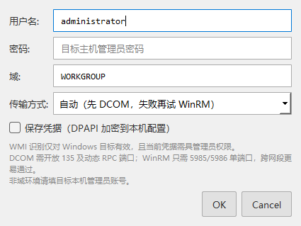
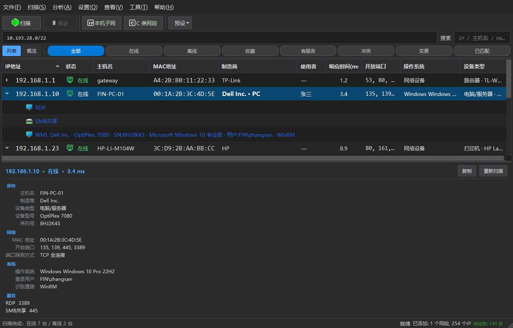
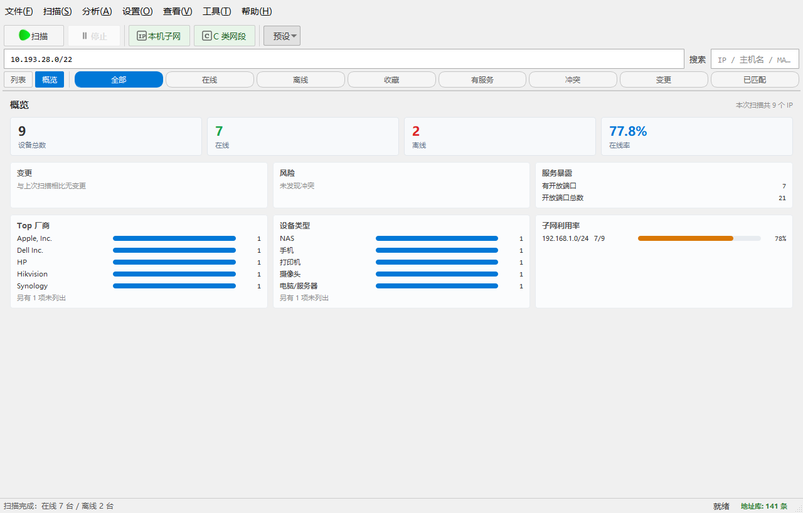
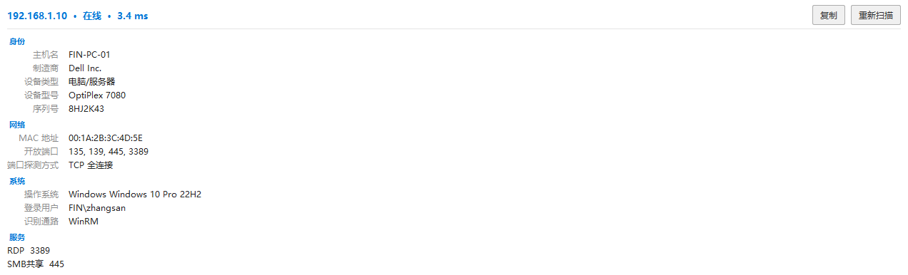
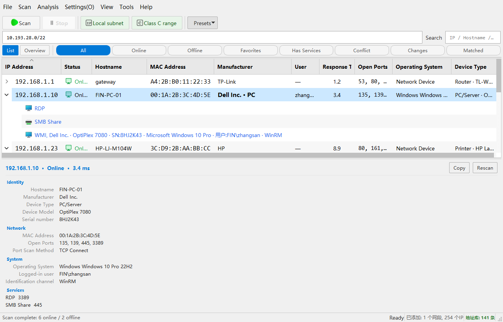

# IPScanner 界面改造验收（第二轮）

> 验收对象：`kooofy/IPScanner` @ `638c462`（`feat(ui): 界面层改造（P0–P3 共 13 项）`，2026-10-09 06:51）
> 对照基准：`UI_REVIEW.md`（同一提交入库的那份，293 行）+ 2026-10-08 那轮基于**实机渲染**的评审
> 验收方式：**跑起来量**，不是读代码猜 —— 真实 Qt 布局（必须 `show()`，否则 `viewport` 尺寸是错的）、
> 逐列读取 `QTreeWidgetItem.foreground()`、`sizeHintForColumn()` 量列宽、像素统计 + WCAG 对比度计算
> 截图目录：`docs/ui-review-round2/`（18 张）

---

## 0. 一句话结论

**方向完全正确，完成度约七成。** 昨天指出的"架构级体验缺口"（没有详情面板、没有空状态、没有概览）
这一轮全部补上了，而且质量不低；`system_theme` 的主题架构（纯函数 + 迁移 + 未知时保持现状）做得比
我建议的还细。**但昨天 4 个 P0 里有 2 个没修完**，而且恰好是最容易被用户看见的那两个：

- **P0-1 深色模式**：顶层行修好了，**服务子项和"已匹配制造商"列仍然不跟随主题** —— 提交信息里
  "颜色统一由 theme_tokens 供给"只落实到了 2 个文件。
- **P0-4 对话框按钮**：**一处都没动**。全项目 93 处 `QMessageBox`，中文界面下按钮仍是 `OK` / `Cancel`。

另外发现 2 个新的、可复现的问题：**英文界面下列宽不重算导致多列截断**，以及**状态栏右侧整段中文
漏翻**（旧账，但英文界面一眼可见）。

---

## 1. 昨天 4 个 P0 的逐项验收

| # | 昨天的问题 | 结果 | 实测证据 |
|---|---|---|---|
| **P0-1** | 深色模式下服务子项 / 已匹配制造商仍是浅色蓝 | ❌ **只修了一半** | 逐列读色：7 处不跟随（子项 6 + 制造商列 1）。深色截图里 `#2563eb` 仍有 **891 px**。对比度 `#2563eb` on `#252526` = **2.96:1**（AA 要求 4.5:1），换成应有的 `#4da6ff` = **5.99:1** |
| **P0-2** | 没有手动切换深色模式的入口 | ✅ **修好** | `设置` 菜单 4 项：跟随系统 / 浅色 / 深色 / 按时间；新装默认 `system`；旧配置 `theme/dark`+`auto_time` 经 `migrate_mode()` 平滑迁移（实测我这台机器迁成了 `light`，外观不变） |
| **P0-3** | 默认列宽溢出（可见列 1578px vs 窗口 1300px） | ⚠️ **只对新装生效** | 新装走「巡检」预设 → 6 列 / **730px**，1280 与 1024 窗口都放得下 ✅。但 `layout_ver` 仍是 3 → **老用户沿用旧 `header_state`：10 列 / 1264px**，1024 窗口下溢出 **262px**（见 18 号截图）。而最小窗口同时从 1200 降到 1024，老用户的溢出反而更严重了 |
| **P0-4** | 所有 Qt 内置对话框按钮是英文 | ❌ **完全未动** | 中文界面实测：`QMessageBox` → `['OK']`；`ui_dialogs.WmiCredentialDialog` → `['OK','Cancel']`。全项目 `QMessageBox.` 调用共 **93 处**，无任何 `setText` / `setLabelText` |





---

## 2. 这一轮做得好的地方（不是客套，都是实测过的）

- **详情面板**（`detail_panel.py`）补上了昨天说的最大架构缺口。身份 / 网络 / 系统 / 服务四段，
  主从布局，可拖拽高度。实测 **SMB 445、RDP 3389 这类无 banner 的服务现在能显示**了
  （提交信息里说的就是这个）—— 这是真的 bug 修复，不是装饰。
- **概览仪表盘**：KPI（总数 / 在线 / 离线 / 在线率）+ 变更 / 风险 / 服务暴露 + Top 厂商 /
  设备类型 / 子网利用率。**英文界面下完全翻译**（NAS / Phone / Printer / Camera / PC-Server
  全对），说明统计层"只算数据、渲染时才 `tr()`"这条纪律执行到位了。
- **主题架构**：`system_theme.resolve_dark()` 是纯函数、用 `_UNSET` 哨兵把"系统偏好未知"和
  "调用方没传"区分开、`migrate_mode()` 保证老用户外观不变 —— 这三点比我建议的方案更细。
  "读不到系统偏好时维持现状而不是变成浅色"这个取舍也是对的。
- **颜色纪律**：4 个新模块（detail_panel / overview / filter_bar / empty_state）**零内联
  `setStyleSheet`**，全部走 QSS objectName。这是昨天 P2-2 想要的结果。
- **空状态页**：给了主 CTA + 当前配置摘要（"未开启端口扫描 · 超时 1000 ms · mDNS 发现已开启"）。
- **筛选条**：8 个 chip 常驻（不做"有变更才出现"的动态显隐 —— 这个判断是对的，位置稳定比省地方重要），
  带实时计数，放不下横向滚动。
- **测试 721 → 870**（我实跑全绿），ruff 干净。新增 6 个测试文件覆盖了纯逻辑层。





---

## 3. 仍未修 / 新发现的问题

### P0-1（续）深色模式下"由 Python 设色"的部分仍不跟随主题

`_apply_theme()` 末尾调 `_refresh_theme_marks()`，而后者只做两件事：遍历 `_ip_item_map`
（**只有顶层项**）刷第 0、1 列。它**从不递归子项**，也**不碰第 4 列**。

| 位置 | 代码位置 | 浅色 | 切深色后 | 应有 |
|---|---|---|---|---|
| 服务子项 ×3 | `main_window_tree.py:312` | `#2563eb` | `#2563eb` ❌ | `#4da6ff` |
| WMI 子项 | `main_window_tree.py:353` | `#2563eb` | `#2563eb` ❌ | `#4da6ff` |
| NetBIOS 子项 | `main_window_tree.py:377` | `#2563eb` | `#2563eb` ❌ | `#4da6ff` |
| 制造商列（已匹配时） | `main_window_tree.py:525` | `#2563eb` | `#2563eb` ❌ | `#4da6ff` |
| 顶层第 0 列 / 状态列 | `_apply_row_marks` | — | — | ✅ 已跟随 |

**雪上加霜的是**：`theme_tokens.py` 建好了、`link` 令牌就是 `("#2563eb", "#4da6ff")`，
但 `main_window.py:1019` 的 `_link_color()` 和 `:1023` 的 `_muted_color()` **仍然硬编码了
一模一样的色值**。全项目 `import theme_tokens` 只有 2 个文件（`main_window_tree.py`、
`ui_icons.py`）—— 令牌模块建起来了却没接上，等于把"两处写同一份色值"的问题换了个地方继续存在。

**建议改法**（3 行）：

```python
# main_window.py
def _link_color(self) -> QColor:
    return QColor(token("link", self.dark_mode))     # 删掉硬编码

def _muted_color(self) -> QColor:
    return QColor(token("muted", self.dark_mode))
```

```python
# main_window_tree.py::_refresh_theme_marks —— 补上子项与第 4 列
for i in range(item.childCount()):
    child = item.child(i)
    if child.foreground(0).style() != Qt.NoBrush:
        child.setForeground(0, self._link_color())
if item.foreground(4).style() != Qt.NoBrush:
    item.setForeground(4, self._link_color())
```

并且**补一条回归测试**：切主题后遍历所有项（含子项）断言前景色等于 `token(..., dark=True)`。
现在的 870 个测试里没有一条覆盖"切主题后颜色是否真的变了"—— 这正是它漏网的原因。

### P0-4 对话框按钮（93 处，一处未动）

昨天给的方案（PyQt5 没有 `qtbase_zh_CN.qm`，必须显式设文案）没有落地。建议做成一个**集中入口**，
而不是在 93 个调用点各写一遍：

```python
# ui_dialogs.py 或新的 ui_i18n.py
def localize_buttons(dlg):                      # QDialogButtonBox / QFileDialog 通用
    ...
def ask(...):                                   # 包一层 QMessageBox，统一走这里
```

`QMessageBox.button(QMessageBox.Ok).setText(tr("确定"))`（PyQt5 **没有** `setButtonText`）、
`QFileDialog.setLabelText(QFileDialog.Accept, tr("保存"))`。新增调用点走封装，旧调用点可分批替换。

### 🆕 P1 英文界面下列宽不重算 → 多列截断

列宽是**按像素**持久化到 `header_state` 的，切语言后**不重算**。中文够用、英文就截断：

| 列 | 当前宽 | 内容需要（`sizeHintForColumn`） | 差 |
|---|---|---|---|
| 状态 | 78px | **84px** | −6px → 显示成 `Onl…` |
| 使用者 | 71px | 76px | −5px → `zhang…` |
| 开放端口 | 96px | 194px | −98px |
| 操作系统 | 150px | 217px | −67px |
| 设备类型 | 120px | 192px | −72px |



顺带说明：中文下"在线"只有 26px，所以**这个问题只在英文界面暴露** —— 纯中文用户永远看不到。

### 🆕 P1 状态栏右侧在英文界面下整段是中文

`main_window.py:1520 / 1526 / 1529 / 1534` 用**裸 f-string** 拼的，没走 `tr()`：

```python
parts.append(f"已添加: {len(self.ip_range_items)} 个网段, {total_ips} 个IP")
parts.append(f"{online} 开机状态, {offline} 关机状态, {unknown} 未知状态")
parts.append(f"{matched} 已匹配")
parts.append(f"⚠ {high} 冲突")
```

英文界面实测显示：`Ready  已添加: 1 个网段, 254 个IP  地址库: 141 条`。
这不是本次提交引入的（`git diff` 确认这几行没动），是 1.7.0 就有的旧账 —— 但英文界面下很显眼。
f-string 拼串天然躲过了现有的 i18n 检查，建议改成带占位符的 `tr()` 键（语言包里已有
`本次扫描共 {n} 个 IP` 这类先例）。

### P2 其它

- **`theme_tokens` 的"单一来源"只覆盖 2 个文件**。`ui_dialogs.py` 里还有约 20 处硬编码色
  （严重级别色 `QColor(220,38,38)`、拓扑连线色、在线/离线色、深色底 `QColor(30,30,30)`），
  深浅两套都写在 Python 里而不是 QSS/令牌里 —— 同一类"深色下漏白"的问题还会再发生。
- **新装默认 IP 降序**：全新安装时排序列 0、顺序**降序**（`.88 → .1`）；沿用已保存布局时是升序。
  排序比较器本身是**数值感知的**（实测 `1.1 < 1.2 < 1.9 < 1.10 < 1.23 < 1.100`，正确），
  只是默认方向不一致。建议显式 `sortByColumn(0, Qt.AscendingOrder)` 把默认钉死。
- **空状态页两个按钮没有主次**：`扫描本机所在子网` 与 `开始扫描` 都是默认样式。后者才是主 CTA。
- **空状态页仍显示筛选条**（"全部"高亮）：没有结果时筛选没有意义，建议随空状态一起隐藏。
- **概览页下半是空白**：820px 高的窗口里内容只占上半部分，约 350px 空着。可以把卡片区
  做等高拉伸，或把"Top 厂商/设备类型"列表多给几条。

---

## 4. 对照同类产品：这一轮补上了什么、还差什么

| 维度 | 改造前 | 现在 | 同类产品（Fing / Advanced IP Scanner / Auvik） |
|---|---|---|---|
| 主从布局（列表 + 详情） | 无 | ✅ 有 | 标配 |
| 空状态 / 首次引导 | 无（一张全空白表） | ✅ 有 | 标配 |
| 概览仪表盘 | 藏在对话框里 | ✅ 常驻一页 | 标配 |
| 主题 | 只有"按时间猜" | ✅ 跟随系统 + 手动四选 | 标配 |
| 结果筛选 | 单个下拉框 | ✅ 常驻 chip + 计数 | 标配 |
| 列宽策略 | 13 列硬铺 | ⚠️ 预设，但**老用户不迁移** | 按窗口自适应 |
| 语义色一致性 | 散落硬编码 | ⚠️ 令牌建好了，**只接了 2 个文件** | 设计系统统一供给 |
| 本地化完整性 | 主界面完整 | ⚠️ 主界面完整，**对话框按钮 + 状态栏漏** | 完整 |
| 图标 | 手绘 QPixmap | ✅ 补了 `setDevicePixelRatio` | 矢量图标集 |

**判断**：这一轮把"形神都像 AIP"变成了"像 2020 年代的工具"，信息架构上已经追平同类。
剩下的差距集中在**收尾**上 —— 都是"最后一公里"的问题：令牌没接完、按钮没本地化、
老用户没迁移、列宽不重算。这些不影响新用户的第一印象，但会影响老用户升级后的观感。

---

## 5. 建议的下一步顺序

**第一批（补完，纯 bug，可立刻发 1.7.1）**

1. `_link_color()` / `_muted_color()` 改走 `theme_tokens`，`_refresh_theme_marks()` 补子项 + 第 4 列
2. 加一条"切主题后所有项（含子项）颜色都变"的回归测试
3. `layout_ver` 3 → 4（让老用户也吃到「巡检」默认列宽；代价是重置自定义列布局，值得）
4. 状态栏 4 条 f-string 改 `tr()`
5. 显式 `sortByColumn(0, Qt.AscendingOrder)`

**第二批（本地化收尾）**

6. 集中式按钮本地化 + 分批替换 93 处 `QMessageBox`
7. 切语言后按当前语言重算列宽（或在 `retranslate` 时对关键列 `resizeColumnToContents`）

**第三批（打磨）**

8. `ui_dialogs.py` 的 ~20 处硬编码色迁到 QSS / 令牌
9. 空状态页主次按钮、空状态隐藏筛选条、概览页垂直空间利用

---

## 6. 截图索引（`docs/ui-review-round2/`）

| 文件 | 说明 |
|---|---|
| `docs/ui-review-round2/01-新装默认-列表-浅色.png` | 全新安装首屏（「巡检」6 列，730px，放得下） |
| `docs/ui-review-round2/02-新装默认-列表-深色.png` | 同上，深色 |
| `docs/ui-review-round2/03-概览仪表盘-浅色.png` | 概览页 |
| `docs/ui-review-round2/04-空状态引导页-浅色.png` / `05-…-深色.png` | 空状态 |
| `docs/ui-review-round2/06-列表-选中设备-浅色.png` | 列表 + 详情面板（选中 192.168.1.10） |
| `docs/ui-review-round2/07-列表-深色-P0-1未修.png` | **P0-1 证据**：子项仍是浅色蓝 |
| `docs/ui-review-round2/08-详情面板-浅色.png` / `09-…-深色.png` | 详情面板单张（深色配色正确） |
| `docs/ui-review-round2/10-英文-列表-状态列被截断.png` | **英文列宽证据**：`Onl…` / `zhang…` |
| `docs/ui-review-round2/11-英文-详情面板.png` / `12-英文-概览.png` / `13-英文-空状态.png` | 英文界面（这三张翻译完整） |
| `docs/ui-review-round2/14-P0-4-对话框按钮仍是英文.png` | **P0-4 证据**：中文界面 + `OK`/`Cancel` |
| `docs/ui-review-round2/15-P0-4-消息框按钮仍是英文.png` | **P0-4 证据**：`QMessageBox` |
| `docs/ui-review-round2/16-老配置-深色-子项未跟随主题.png` | 老配置 + 深色（另一份 P0-1 证据） |
| `docs/ui-review-round2/17-最小窗口1024-概览.png` / `18-最小窗口1024-列表-老配置溢出.png` | 1024×640 最小窗口；后者溢出 262px |

---

## 7. 附：本次验收中对昨天结论的更正

- 昨天写"状态列 78px 放不下英文 `Online`/`Offline`（需 84/86px）"。中途我用"文本宽度
  只有 40px"一度以为算错了；**用 `sizeHintForColumn(1)` 复核后确认昨天是对的** —— 单元格
  需求宽度 = 图标 18px + 间距 + 文本 40px + QSS 的 `padding: 4px 6px`，合计 **84px** > 78px。
  "文本宽度"和"单元格需求宽度"是两回事，这里记一笔以免下次再绕。
- 另一处方法教训：**量 Qt 布局前必须 `show()`**。不 `show()` 时 `viewport()` 只有 626px
  （真实值 1258px），会得出"溢出 638px"这种完全错误的结论。第一次跑的时候就踩了。
